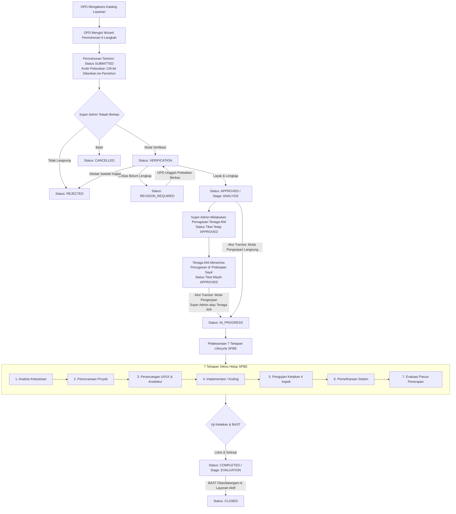
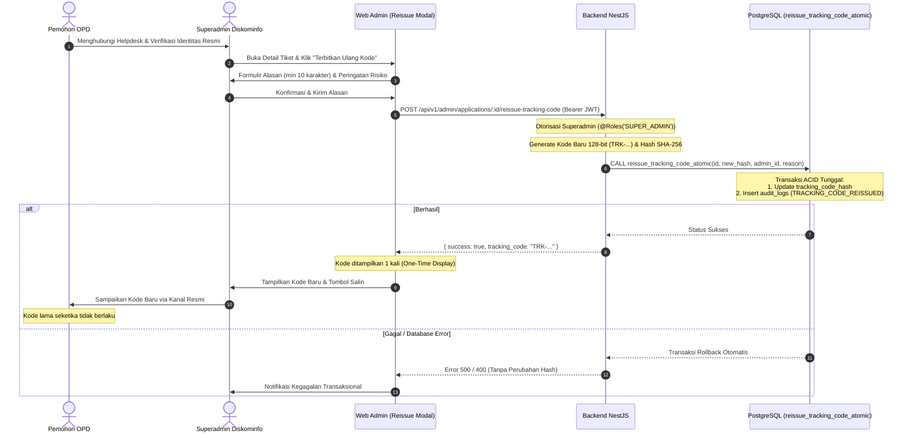

# SIMANTIK — System Context & Master Architectural Guide
## Sistem Manajemen Layanan Teknologi Informasi
**Pemerintah Daerah Kabupaten Bandung — Dinas Komunikasi dan Informatika (Diskominfo)**

---

## 1. Ringkasan Eksekutif & Tujuan Sistem

**SIMANTIK (Sistem Manajemen Layanan Teknologi Informasi)** adalah platform digital terpadu milik Dinas Komunikasi dan Informatika (Diskominfo) Pemerintah Daerah Kabupaten Bandung. Sistem ini dirancang untuk menstandarisasi, mengelola, memverifikasi, dan mendokumentasikan seluruh siklus hidup pembangunan dan pengembangan aplikasi perangkat lunak yang diusulkan oleh Perangkat Daerah (OPD) di lingkungan Pemerintah Kabupaten Bandung.

Landasan regulasi dan tata kelola sistem ini mengacu pada:
1. **Peraturan Presiden No. 95 Tahun 2018** tentang Sistem Pemerintahan Berbasis Elektronik (SPBE).
2. **Peraturan Menteri Komunikasi dan Digital No. 6 Tahun 2025** tentang Pedoman Pembangunan dan Pengembangan Aplikasi SPBE.
3. **Standar Operasional Prosedur (SOP) Layanan Aplikasi Diskominfo Kabupaten Bandung**.

### Masalah Utama yang Diselesaikan
Sebelum adanya SIMANTIK, permohonan aplikasi dari OPD sering diajukan secara parsial melalui surat fisik atau pesan instan tanpa standardisasi Kerangka Acuan Kerja (KAK), tanpa pengujian kelaikan keamanan/fungsi, dan tanpa riwayat pemeliharaan terpusat. SIMANTIK menyelesaikan masalah ini dengan:
- Menyediakan katalog layanan terstandarisasi dengan persyaratan dokumen wajib.
- Menyediakan pelacakan publik transparan bagi pemohon OPD berbasis kode unik 128-bit tanpa perlu membuat akun login.
- Menyediakan fasilitas penerbitan ulang kode pelacakan darurat yang terproteksi dan terisolasi audit jika kode hilang.
- Menyediakan konsol terpadu bagi administrator dan Tenaga Ahli Diskominfo untuk menelaah, menguji, dan mendokumentasikan 7 tahapan siklus hidup aplikasi (Siklus Hidup SPBE).
- Memastikan jejak audit yang tidak dapat diubah (*append-only immutable audit log*) untuk akuntabilitas hukum dan pengawasan inspektorat.

---

## 2. Arsitektur Tiga Lapis (*Three-Tier Architecture*)

SIMANTIK mengadopsi arsitektur tiga lapis yang memisahkan kanal publik, konsol manajemen internal, dan backend berwenang tunggal (*authoritative backend*):

```
┌──────────────────────────────────────────────┐        ┌──────────────────────────────────────────────┐
│        Web Layanan (Pemohon Publik OPD)      │        │        Web Admin (Diskominfo Internal)       │
│  - Katalog Layanan & Unduh Format KAK        │        │  - Dashboard Statistik & Antrean Tiket       │
│  - 6-Step Submission Wizard (/ajukan)        │        │  - Verifikasi Administrasi & Telaah Teknis   │
│  - Pelacakan Tiket Publik (/tracking)        │        │  - Penugasan Tenaga Ahli & "Pekerjaan Saya" │
│  - Diskusi Tiket Publik & Pengiriman Revisi  │        │  - 7 Tahapan Lifecycle Workspace & Pengujian │
│  - Hero Sabilulungan & Panduan Layanan       │        │  - Modal Penerbitan Ulang Kode Pelacakan     │
│  [React 19 + Vite + Tailwind, Port 5173]     │        │  - Master OPD, Layanan, Akun & Audit Trail   │
│  (100% Bebas Koneksi Langsung ke Supabase)   │        │  [React 19 + Vite + Tailwind, Port 5174]     │
└──────────────────────┬───────────────────────┘        └──────────────────────┬───────────────────────┘
                       │                                                       │
                       │ HTTP/REST (Anon / Tracking Token)                     │ HTTP/REST + Bearer JWT (Supabase Auth)
                       ▼                                                       ▼
┌──────────────────────────────────────────────────────────────────────────────────────────────────────┐
│                                       Backend API (NestJS Monolith)                                  │
│  - Port 3000 | Global Prefix `/api/v1` | Runtime: NestJS 12 + Express                                 │
│  - Centralized Workflow Engine (Validasi Status, Role & Transisi Tahap SPBE)                         │
│  - Security Suite: Rate Limiter, Timing-Safe Token Hash, Exception Filter, Whitelist File Validator   │
│  - Business Layer: Applications, Assignments, Lifecycle, Messages, Notifications, Tracking, Audit    │
│  - Atomic Reissue Engine: Transaksi RPC PostgreSQL untuk pembaruan hash & audit log aman             │
│  - Storage Signer: Menerbitkan Signed URL Privat Sementara (15 Menit)                                │
└──────────────────────────────────────────────────┬───────────────────────────────────────────────────┘
                                                   │
                                                   │ Koneksi Eksklusif Menggunakan Service-Role Key (Bypass RLS)
                                                   ▼ Otorisasi & Kontrol Akses Ditegakkan Otoritatif di NestJS
┌──────────────────────────────────────────────────────────────────────────────────────────────────────┐
│                                       Supabase / PostgreSQL Database                                 │
│  - Database Relasional PostgreSQL 17 (21 Tabel Skema Public + 1 Tabel auth.users)                   │
│  - 15 Berkas Migrasi SQL Terkelola (Fondasi awal hingga fungsi RPC atomik)                           │
│  - 0 Database Views, 14 Custom ENUM Types, 15 Database Triggers                                      │
│  - RLS Default-Deny pada seluruh tabel publik terhadap role `anon` dan `authenticated` (Defense-in-depth) │
│  - Trigger Proteksi `trg_prevent_audit_log_update_delete` (Append-Only Audit Trail pada audit_logs)   │
│  - Fungsi Transaksional `public.reissue_tracking_code_atomic` (SECURITY DEFINER, search_path = '')   │
│  - Storage Bucket Privat `simantik-documents` (Private Object Storage, Max 10MB)                    │
│  - Supabase Auth: Kelola Kredensial & Sesi Staf (SUPER_ADMIN, TECHNICIAN)                            │
└──────────────────────────────────────────────────────────────────────────────────────────────────────┘
```

### Catatan Arsitektur: Rute Endpoint Lifecycle Kanonis (`/api/v1/applications/:id/lifecycle`)
* **Backend Prefix Global**: `main.ts` menetapkan `app.setGlobalPrefix('api/v1')`.
* **Path Controller**: `lifecycle.controller.ts` didekorasikan secara kanonis dengan `@Controller('applications/:id/lifecycle')`.
* **Rute Aktual NestJS**: NestJS mendaftarkan endpoint kanonis sebagai `/api/v1/applications/:id/lifecycle`.
* **Pemanggilan Klien**: Hook frontend Admin Web `useLifecycle.ts` memanggil `/applications/${applicationId}/lifecycle` via `apiFetch`, yang digabungkan dengan `apiBaseUrl` (`http://localhost:3000/api/v1`) sehingga peramban merequest `/api/v1/applications/:id/lifecycle`.

---

## 3. Struktur Direktori Repositori

```text
D:\Projects\simantik/
├── .agents/                    # Konfigurasi agen, skill, dan aturan IDE
├── .vscode/                    # Konfigurasi workspace editor
├── backend/
│   └── api/                    # Aplikasi Backend NestJS
│       ├── src/
│       │   ├── admin/          # Controller agregasi dashboard & healthcheck admin
│       │   ├── applications/   # Modul permohonan, workflow engine, & reissue tracking code
│       │   ├── assignments/    # Modul penugasan Tenaga Ahli & workspace "Pekerjaan Saya"
│       │   ├── audit/          # Layanan audit log otomatis (append-only)
│       │   ├── auth/           # Guards (AuthGuard, RolesGuard), decorator, & tipe sesi
│       │   ├── common/         # Global exception filter, validator file, & tes keamanan
│       │   ├── config/         # Konfigurasi environment (port, cors, credentials)
│       │   ├── health/         # Endpoint health check (/api/v1/health)
│       │   ├── helpdesk/       # Modul FAQ dan kontak konsultasi helpdesk
│       │   ├── lifecycle/      # Modul 7 tahapan siklus hidup SPBE & uji kelaikan
│       │   ├── messages/       # Modul komunikasi tiket (publik vs catatan internal)
│       │   ├── notifications/  # Modul notifikasi in-app & email transaksional
│       │   ├── opd/            # Master data Perangkat Daerah (OPD) Kabupaten Bandung
│       │   ├── scripts/        # Skrip audit & penyiapan akun lokal
│       │   ├── services/       # Master katalog layanan SPBE & checklist persyaratan
│       │   ├── supabase/       # Adapter koneksi Supabase client (service role)
│       │   ├── technicians/    # Modul manajemen profil & akun Tenaga Ahli
│       │   ├── tracking/       # Modul pelacakan publik, rate limiter, & tracking token
│       │   ├── app.module.ts   # Root module NestJS
│       │   └── main.ts         # Entry point backend (Port 3000, body limit 50MB, CORS)
│       ├── test/               # Konfigurasi e2e & test fixtures
│       └── package.json        # Skrip: build, start:dev, test (vitest), lint (oxlint)
├── docs/                       # Dokumentasi resmi sistem
│   ├── PRD.md                  # Product Requirements Document baseline
│   ├── TECHNICAL-SPEC.md       # Spesifikasi teknis arsitektur lengkap
│   ├── HANDOVER.md             # Dokumen serah terima & batasan sistem
│   ├── SIMANTIK_SYSTEM_CONTEXT.md          # Dokumen induk konteks sistem (berkas ini)
│   ├── SIMANTIK_DECISIONS_AND_CHANGELOG.md # Log keputusan & catatan perubahan
│   └── PANDUAN_MEMBUKA_SISTEM.md           # SOP & langkah menjalankan sistem lokal
├── frontend/
│   ├── admin-web/              # Web Admin Diskominfo (Konsol Manajemen)
│   │   ├── src/
│   │   │   ├── app/            # Router konfigurasi React Router v7
│   │   │   ├── components/     # UI design tokens, layout (Sidebar, Header), shared UI
│   │   │   ├── features/       # Feature modules: lifecycle workspace, messages, auth, applications
│   │   │   ├── pages/          # 17 halaman admin (Dashboard, Detail, My Work, dsb.)
│   │   │   ├── types/          # Deklarasi tipe TypeScript antarmuka admin
│   │   │   ├── index.css       # Tailwind utility & styling tema institusional Pemkab
│   │   │   └── main.tsx        # React DOM entry point (Port 5174)
│   │   └── package.json        # Skrip: dev, build, lint
│   └── service-web/            # Web Layanan Publik Pemohon OPD
│       ├── src/
│       │   ├── components/     # UI design tokens, layout (PublicLayout, Header, Footer)
│       │   ├── hooks/          # React Query hooks (useServices, useTracking, useSubmit)
│       │   ├── lib/            # Wizard step logic, client file validation
│       │   ├── pages/          # 8 halaman publik (Home Sabilulungan, Layanan, Ajukan, dll.)
│       │   ├── index.css       # Tailwind utility & styling publik
│       │   └── main.tsx        # React DOM entry point (Port 5173)
│       └── package.json        # Skrip: dev, build, lint
├── incoming-brand-assets/      # Master logo resmi Kabupaten Bandung, Diskominfo, SIMANTIK
├── supabase/
│   ├── migrations/             # 15 berkas SQL migrasi skema, RLS, Storage, hardening, & atomic RPC
│   ├── config.toml             # Konfigurasi Supabase CLI
│   └── simantik_comprehensive_reset_20261013.sql # Skrip referensi reset historis
├── package.json                # Root package.json
└── README.md                   # Panduan instalasi dan deployment cepat
```

---

## 4. Alur Bisnis dan Siklus Hidup Permohonan

Proses bisnis SIMANTIK mengikuti alur linier dengan titik kontrol ketat:



---

## 5. Alur Penerbitan Ulang Kode Pelacakan (Tracking Code Reissue)

Jika pemohon OPD kehilangan kode pelacakan rahasia, sistem menyediakan alur pemulihan darurat tanpa mengubah nomor tiket, status, atau dokumen yang telah ada:



---

## 6. Model Data dan Relasi Basis Data

Basis data SIMANTIK terdiri dari **21 tabel relasional pada skema `public`**, **1 tabel terkelola sistem pada skema `auth` (`auth.users`)**, **0 database views**, **14 custom ENUM types**, **15 database triggers**, **1 fungsi RPC atomik**, dan **1 bucket penyimpanan objek privat (`simantik-documents`)**:

### A. Tabel Master & Identitas (Wajib Dipertahankan)
1. `auth.users` *(Skema `auth`)*: Kredensial akun Supabase Auth (email, encrypted password, metadata).
2. `public.profiles`: Profil pengguna terautentikasi internal Diskominfo (ID 1:1 ke `auth.users`, nama lengkap, role `SUPER_ADMIN` atau `TECHNICIAN`, status aktif `is_active`).
3. `public.opd_units`: Master 13 unit kerja Perangkat Daerah di Kabupaten Bandung.
4. `public.services`: Katalog 2 layanan SPBE (`Pembangunan Aplikasi Baru` dan `Pengembangan Aplikasi Eksisting`).
5. `public.service_requirements`: 10 item persyaratan berkas per layanan (surat permohonan, KAK, SOP, dll.).

### B. Tabel Transaksional & Operasional Permohonan
6. `public.applicants`: Snapshot identitas PIC pemohon OPD pengusul.
7. `public.applications`: Data inti permohonan (nomor tiket unik `SIM-YYYY-XXXXXX`, hash SHA-256 kode pelacakan `tracking_code_hash`, judul, status, stage).
8. `public.application_documents`: Metadata berkas persyaratan yang diunggah pemohon (storage path, MIME type, ukuran).
9. `public.assignments`: Riwayat penugasan Tenaga Ahli (ID teknisi, catatan, stempel waktu, penanda aktif `is_current`).

### C. Tabel Riwayat Workflow
10. `public.application_status_history`: Catatan kronologis mutasi status operasional.
11. `public.application_stage_history`: Catatan kronologis perpindahan tahapan siklus hidup.

### D. Tabel Dokumentasi 7 Tahapan Siklus Hidup SPBE
12. `public.analysis_records`: Dokumen analisis kebutuhan SPBE.
13. `public.project_plans`: Rencana kerja teknis dan timeline.
14. `public.design_records`: Dokumentasi arsitektur & desain.
15. `public.implementation_records`: Catatan pelaksanaan pembangunan modul & konfigurasi instalasi.
16. `public.technical_documents`: Metadata dokumen teknis tambahan.
17. `public.test_records`: Rekaman hasil uji kelaikan 4 aspek (Fungsi, Integrasi, Beban, Keamanan).
18. `public.maintenance_records`: Riwayat pemeliharaan aplikasi (Korektif, Adaptif, Perfektif, Preventif).
19. `public.evaluations`: Evaluasi pasca-implementasi dan capaian keberhasilan SPBE.

### E. Tabel Komunikasi, Notifikasi & Audit
20. `public.messages`: Pesan diskusi tiket dengan pemisahan visibilitas (`PUBLIC` vs `INTERNAL`).
21. `public.notifications`: Antrean notifikasi internal staf in-app & email transaksional pemohon.
22. `public.audit_logs`: Jejak audit forensik append-only dengan trigger proteksi mutasi.

---

## 7. Keamanan dan Kontrol Akses (Security & RBAC)

| Aspek Keamanan | Implementasi Teknis Aktual |
| :--- | :--- |
| **Otorisasi Database vs Backend** | **Pemisahan Peran Tegas**: Backend NestJS terhubung ke Supabase menggunakan `SUPABASE_SECRET_KEY` (service-role key) yang membypass RLS PostgreSQL. Seluruh otorisasi pengguna (RBAC, pencegahan akses lintas OPD, penugasan Tenaga Ahli, penerbitan ulang kode pelacakan) **ditegakkan secara otoritatif pada layer aplikasi NestJS** (`AuthGuard`, `RolesGuard`, `workflow.engine.ts`). Kebijakan RLS *Default-Deny* pada PostgreSQL bertindak sebagai pertahanan tambahan (*defense-in-depth*). |
| **Audit Immutability** | Trigger PostgreSQL `trg_prevent_audit_log_update_delete` memblokir operasi `UPDATE` dan `DELETE` pada tabel `audit_logs` secara permanen (melempar error `P0001`). |
| **Transaksi Atomik Penerbitan Kode** | Fungsi RPC `public.reissue_tracking_code_atomic` menjamin bahwa pergantian hash kode pelacakan dan pencatatan audit `TRACKING_CODE_REISSUED` dieksekusi secara ACID. Jika audit gagal, hash tidak berubah. |
| **Keamanan Search Path RPC** | Fungsi `reissue_tracking_code_atomic` dideklarasikan dengan `SECURITY DEFINER` dan `SET search_path = ''` dengan kualifikasi skema eksplisit untuk mencegah serangan pembajakan skema (schema hijacking). Hak `EXECUTE` dibatasi hanya untuk `service_role`. |
| **Entropi Kriptografis 128-bit** | Kode pelacakan digenerate menggunakan `crypto.randomBytes(16)` (128 bit keacakan murni). Basis data hanya menyimpan digest SHA-256. |
| **Privasi Penyimpanan Berkas** | Bucket Supabase Storage `simantik-documents` berstatus `public = false`. Berkas hanya dapat diunduh melalui *Signed URL* sementara (15 menit). |
| **Validasi Berkas Ketat RFC 4648** | Menguji keselarasan Base64 RFC 4648, menolak non-canonical padding bits, trailing garbage, sanitasi nama berkas (maks 255 char), dan memverifikasi magic bytes biner asli. |
| **Storage Object Key UUID Acak** | Format Storage key `${prefix}/${crypto.randomUUID()}.${safeExt}` tanpa nama file asli di path, mengeliminasi risiko path traversal dan kebocoran metadata di storage. |
| **Anti-Brute Force Pelacakan** | `TrackingRateLimiter` membatasi verifikasi kode pelacakan publik hingga maksimal 5 kali kegagalan per IP/tiket (HTTP 429). |
| **Pencegahan Timing Attack** | Verifikasi kode pelacakan menggunakan `crypto.timingSafeEqual` pada digest SHA-256 (32 byte). |
| **Penyensoran Error Database** | `HttpExceptionFilter` menangkap error database PostgreSQL dan menyensor detail internal driver basis data. |

---

## 8. Ringkasan Perintah Pengembangan & Pengujian

### Perintah Menjalankan Server Lokal (Root)
```bash
# 1. Jalankan Backend API (Port 3000)
npm run dev:backend

# 2. Jalankan Web Layanan Publik (Port 5173)
npm run dev:service

# 3. Jalankan Web Admin Diskominfo (Port 5174)
npm run dev:admin
```

### Perintah Pengujian & Kompilasi Aktual
* **Backend API Unit & Integration Tests**:
  - Perintah: `npm --prefix backend/api test` (Vitest v4.1.11)
  - Hasil Aktual: **16 test files passed, 276 tests passed (100%)**, durasi ~3.1 detik.
* **Frontend Service Web Regression Tests**:
  - Perintah: `npm --prefix frontend/service-web test`
  - Hasil Aktual: **1 test file (`submissionWizard.spec.ts`), 7 tests passed (100%)**.
* **Kompilasi Produksi (Production Build)**:
  - `backend/api`: `nest build` → **Exit Code 0** (sukses).
  - `frontend/admin-web`: `tsc -b && vite build` → **Exit Code 0** (sukses).
  - `frontend/service-web`: `tsc -b && vite build` → **Exit Code 0** (sukses).

---

## 9. Keterbatasan yang Diketahui & Mitigasi Arsitektur

1. **Rate Limiter Berbasis In-Memory**:
   - *Kondisi*: `TrackingRateLimiter` menyimpan counter kegagalan verifikasi tiket dalam RAM instance Node.js.
   - *Mitigasi Masa Depan*: Jika backend dideploy dalam arsitektur multi-instance/kluster tanpa sticky session, gunakan penyimpanan state terpusat seperti Redis.
2. **Pemindaian Berkas Unggahan**:
   - *Kondisi*: Validasi berkas saat ini mengandalkan ekstensi, MIME type, dan magic number signature. Belum ada antivirus engine aktif (ClamAV) yang memindai malware secara real-time.
   - *Mitigasi Masa Depan*: Tambahkan worker scanning asynchronous sebelum berkas ditandai `is_current = true`.

---

## 10. Panduan Standar Alur Kerja Pengembangan

1. **Prinsip Otoritas Backend**: Backend adalah lapisan penegakan aturan bisnis utama. Frontend bertindak sebagai cerminan tampilan. Jangan hanya menyembunyikan tombol di UI tanpa validasi di `workflow.engine.ts` atau service backend.
2. **Perlindungan Data Master**: Jangan pernah menjalankan operasi mutasi (`DELETE`, `TRUNCATE`, `UPDATE`) pada tabel master: `profiles`, `auth.users`, `opd_units`, `services`, dan `service_requirements`.
3. **Pemisahan Istilah Internal vs Tampilan**:
   - Identifier internal database, enum, API route, dan RBAC guard tetap menggunakan **`TECHNICIAN`**.
   - Teks antarmuka pengguna (user-facing UI) dan pesan kesalahan bahasa Indonesia harus selalu menggunakan istilah **`Tenaga Ahli`**.
4. **Prosedur Pembaruan Kode & Git**:
   - Setiap pembaruan kode harus divalidasi dengan pengujian unit otomatis yang relevan.
   - Perubahan basis data wajib melalui berkas migrasi SQL terurut pada `supabase/migrations/`.
   - Gunakan staging selektif dengan path eksplisit dan verifikasi `git diff --check` sebelum melakukan commit.
